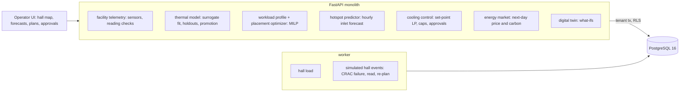

# Data Center Cooling & Workload Placement Optimizer

For a colocation or AI compute operator: it fits a thermal model of a machine hall to the hall's own sensor history, places a surge of
GPU training jobs where the model says the heat will do least harm, raises the cooling set-points as far as the predicted inlets allow,
and, when a CRAC unit stops, acts on what the sensors read rather than on what the model predicted, proposing the smallest GPU power
caps that bring every rack back under the limit, for a person to approve.

Built from blueprint 19 of "Advanced Engineering Build Book, Volume IV" as a **vertical slice**: the demo scenario end to end, with the
platform parts real and the rest listed under [Not built](#not-built-and-why).

**The hall, its racks, loads, sensors, CRACs, prices and the physics that moves heat through it are generated by a lumped simulator in
this repository (`dc/world.py`). It is not CFD and not a real data center. The models see only the simulated sensor readings and the
inventory; the simulator's true temperatures are used only to score them.**

## Run it

```bash
docker compose up --build        # migrates, seeds, serves http://localhost:8410/ui/ with one worker
docker compose run --rm test     # 9 tests against a throwaway database
```

Open http://localhost:8410/ui/ and press **Run all steps** (about 5 seconds), or `make bootstrap demo`.
Demo tokens (local only): `hall-facility_manager-demo`, `hall-operator-demo`, `hall-viewer-demo`. Run `make reset` before a second demo run.

## The demo, step by step

1. An invented hall: four rows of twelve racks facing two cold aisles, a CRAC unit at each end of each aisle, 27 GPU servers already
   installed, 416 kW of IT on an average day. Sixty days of hourly telemetry (218,524 readings: inlet temperature at the top of each
   rack, power on each rack's CPU and GPU branches, each unit's supply temperature and status, one eight-hour maintenance stop per unit).
   Five live readings arrive; an unknown sensor, an 85 °C inlet and a timestamp from the future are refused.
2. The thermal model is fitted to the readings: per rack, the supply air of each unit, which units were stopped, and the power of every
   rack in the same aisle. On the ten days held back it is off by 0.22 °C on average (99% within 0.70 °C); the design rule of thumb,
   supply air plus 1.5 °C, is off by 0.81 °C. With each unit's maintenance stop held out in turn it is off by 0.2–0.3 °C. It is promoted.
3. Six training jobs, 24 servers of 10 kW, each within one row for its network. The scheduler's first fit puts all of them in row A,
   aisle 1 at 519 kW against 246 kW in aisle 2. The thermal-aware MILP spreads them (439 / 326 kW) and predicts a hottest inlet of
   22.3 °C against 25.5 °C. In the simulated hall at 18 °C neither overheats (24.3 °C and 22.6 °C). The surge is past any load in the
   history, so the margin doubles to 1.4 °C and each aisle's airflow is held under 85% of what its units deliver.
4. The cooling LP raises the set-points to 21 / 21 / 22.5 / 21 °C, the hottest predicted inlet 25.4 °C. The simulated hall's hottest
   rack reaches 26.6 °C; cooling energy for the day falls from 7.2 to 5.6 MWh (22%), PUE from 1.476 to 1.382, cooling cost from $462
   to $359 at the next day's prices.
5. The what-if on the model: CRAC-1 stops at the afternoon peak. The model predicts 25.7 °C and nothing over the limit; the simulated
   hall would reach 36.4 °C with 24 racks over 27 °C. The model flags itself: aisle 1 would need 138% of the air its remaining unit
   delivers, and the most it ever saw was 80%. Then the hall loses CRAC-1. The automatic response sets the other units to 16 °C; ten
   minutes later the sensors read 31.6 °C with 16 racks over 27 °C. The readings correct the model and the re-plan proposes power caps
   on eight aisle-1 racks, 77 kW of GPU power, for approval.
6. The operator cannot approve caps on customers' GPUs; the facility manager does. The simulated hall then runs the day at 25.1 °C at
   worst with no rack over 27 °C, 69 kW of GPU power given up. PUE for the next day as it stands: 1.547 (last week, before the surge:
   1.509). Every step is in a hash-chained audit log.

## Architecture



| Piece | How it works |
|---|---|
| Simulated hall (`dc/world.py`) | 4 rows × 12 racks in two cold aisles; four CRACs with commissioning airflow. A rack's inlet is the mix of the units' supply air (more from the nearer unit, 10% from the other aisle's), plus recirculated exhaust from racks in the same aisle (strongest at the row ends), plus, when an aisle asks for more air than it receives past a hidden knee, hot air drawn into the racks furthest from a running unit. Sensors carry a fixed offset per rack and noise; 0.5% of readings are lost. Chiller power from the HP Labs CRAC COP curve. Hidden per hall: recirculation strength, row-end factor, air mixing length, the knee (86–94% airflow use) and its severity. |
| Thermal model | Per rack: inlet = intercept + Σ supply air of each unit (a stopped unit's term takes the running units' mean) + stopped flags + Σ power of every rack in the aisle, by bounded ridge regression (no negative heat or supply terms). Fitted on fifty days, checked on ten, and refitted four times with each unit's maintenance window held out. Promoted if the 99th-percentile error is under 1.5 °C and it beats the design rule. |
| Safety margin and envelope | Margin: the 99th-percentile error on the held-back days; with a unit stopped, the worst of that and the held-out maintenance windows. Outside the aisle loads it was fitted on, the margin doubles and the airflow rule (aisle IT airflow ≤ 85% of what its units deliver, from commissioning figures) is added. |
| Heat forecast | Each rack's CPU heat by hour of day: the mean of the last fourteen days. GPUs planned at nameplate. |
| Placement | `scipy.optimize.milp` (HiGHS): servers per rack (integer, within free slots and the PDU), one row per job (binary), minimising the hottest predicted inlet at the forecast peak hour, with a small tie-break towards a cooler hall. First fit is the scheduler's default it is compared with. |
| Cooling plan | LP over the running units' set-points (16–27 °C, half degrees) maximising their sum, every predicted inlet the margin under 27 °C. Applied automatically: lowering risk is the margin's job. |
| CRAC failure | Automatic: running units to 16 °C. Ten minutes later the sensors read; in an aisle using more than 85% of its air, the gap between reading and prediction is taken as starvation proportional to airflow use above 85%, elsewhere as an offset. LP over set-points and GPU power caps (50–100%, 5% steps) capping as little GPU power as it can. Caps need the facility manager. If no plan exists: GPUs in the starved aisle at 50% and a review task. |
| Platform | Row-level security per operator, Postgres job queue, Idempotency-Key replay, hash-chained audit log, decision records with model version, inputs hash, confidence and policy state, `/metrics`. |

## Data model

`migrations/002_dc.sql` follows the blueprint (facility, room, rack, server, cooling_unit, sensor, workload, placement, thermal_state,
control_action, energy_price, model_artifact, decision_record); additions are marked `(+)`: the facility's seed and clock, a `telemetry`
table of raw readings (hourly here; a time-partitioned store at production rates), unit status as a sensor, model parameters, who made a
decision. `thermal_state` holds predicted and measured inlet per rack for each decision, the evidence behind it.

## API

| Method | Endpoint | Purpose |
|---|---|---|
| POST | `/v1/facilities/load` | (+) 202 + job: the synthetic hall and sixty days of telemetry |
| GET | `/v1/facilities/{id}` | (+) Racks, load, GPU servers, free slots, units, last day's temperatures |
| POST | `/v1/telemetry` | Readings, each checked: sensor, time zone, future, range, duplicate |
| POST | `/v1/thermal/models/fit` | (+) Fit, hold out, promote; recirculation learned against the truth |
| POST | `/v1/placements/optimize` | GPU jobs placed by first fit and thermal-aware MILP; the latter adopted |
| GET | `/v1/thermal/forecast` | Hourly hottest-inlet forecast with margin for a placement, and hotspots |
| POST | `/v1/cooling/plan` | Set-point LP, applied; energy, PUE, cost and carbon against 18 °C |
| POST | `/v1/twin/simulate` | What-if: a unit stops; prediction with no action and with the runbook, and the model's confidence |
| POST | `/v1/room/events` | (+) Simulated hall only, 202 + job: a unit stops; automatic response, readings, re-plan |
| POST | `/v1/decisions/{id}/approve` | (+) Facility manager approves pending caps and set-points |
| GET | `/v1/facilities/{id}/pue` | PUE last week (metered IT) and next day as planned, with cost |

Contract: [`docs/openapi.json`](docs/openapi.json).

## Measured

[`docs/evaluation.md`](docs/evaluation.md) (`python -m dc.evaluate`: five halls the demo never uses, the same surge, each of the four
units stopped in turn after each placement) and [`docs/performance.md`](docs/performance.md).

| Component | Result | Baseline |
|---|---|---|
| Thermal model, ordinary days | 0.22 °C against readings, 0.29–0.34 °C against the true inlet | design rule 0.72–0.86 °C |
| Hottest inlet after the surge, predicted | rack error 0.39–0.70 °C; worst under-prediction 1.5–2.9 °C (thermal-aware), 0.8–3.0 °C (first fit) | |
| Cooling plan, thermal-aware placement | 23–29% less cooling energy than 18 °C, no rack over 27 °C | first fit with its own plan: 7–21% |
| A unit stops, thermal-aware placement (20 cases) | closed loop: no rack over 27 °C in 20, mean 19 kW of GPU capped | runbook alone: 7 of 20 over; no action: 20 of 20 |
| A unit stops, first fit (20 cases) | closed loop: none over, mean 75 kW capped; 3 needed the fallback (184–189 kW) | runbook alone: 10 of 20 over |
| The model's own failure prediction | flagged 4 of the 32 failures that put a rack over 27 °C; 2.0–18.9 °C too cool | |
| Open-loop re-plan (model + airflow rule, no readings) | no plan found in 20 of 40; when found, safe but 42–90 kW capped on average | |

Three things these numbers say plainly. The thermal model is good at what it has seen and blind to what it has not: it never saw an aisle
starved of air, so with a unit stopped at surge load it predicted 2–19 °C too cool, and a system that acted on its prediction would have
cooked racks. The closed loop works because it trusts the sensors over the model, not because the model is right. The design rule of
thumb and the runbook are not bad: the runbook alone kept 13 of 20 thermal-aware failures within the limit, at full cooling cost, and
the model's main contribution there is the few racks the runbook misses and the power caps sized to them. Second, placement mattered less
than expected on an ordinary day (neither plan overheated at 18 °C) and more when a unit failed: first fit's crowded aisle needed four
times the caps. Third, the cooling saving rests on the margin; on the five halls the planned set-points kept the hottest rack 0.4–1.1 °C (thermal-aware)
under the limit, with the worst-predicted rack up to 3 °C too cool, so the doubled margin is doing real work.

## The hardest tradeoff

When to trust the model. Acting on predictions is what saves energy, and the model is excellent inside its experience (a fifth of a
degree). The same model, asked about a stopped unit at twice the load it was fitted on, said everything would be fine while the hall
went past 36 °C. The design draws the line explicitly: an envelope check (aisle airflow use against the most seen with a unit down) that
turns a prediction into a recommendation to act on the sensors; a safe automatic reflex that needs no model (every unit to 16 °C); and a
re-plan that starts from readings and only asks the model for the shape of the answer. The cost is visible: on failures the closed loop
uses more cooling energy than an open-loop plan would, and it caps GPUs that a lucky runbook might not have needed to.

## Threat model (summary)

| Threat | Mitigation here | Gap |
|---|---|---|
| A bad reading steering a plan | Unknown sensors, missing time zones, future times, out-of-range values and duplicates refused one by one; fits use only complete hours | No cross-checking of a sensor against its neighbours |
| A model outside its experience acting on the hall | Envelope check; margin doubled; airflow rule; failures handled from readings with a model-free first response | The envelope is two numbers per aisle, not a density estimate |
| Capping customers' GPUs without consent | Caps are `needs_approval`; only the facility manager role can approve; the decision, actions and approver are audited | No customer notification channel |
| One operator seeing another's hall | Row-level security on every table; tested through the API and directly in the database | |

## Not built, and why

- **CFD**: the blueprint's "CFD-derived surrogate" is replaced by one fitted to sensor history; a CFD run per layout would be the way to
  give the model the starved-aisle experience the history lacks.
- **Live migration and pausing of jobs**: the re-plan has set-points and power caps; moving a training job means checkpoint and restart,
  which the scheduler owns.
- **Chiller plant, economisers, humidity, rack-level airflow sensors**: cooling is one COP curve per unit.
- **Carbon- or price-aware scheduling of the jobs themselves**: prices and carbon are reported, not optimised.
- **SSE progress streams, Kafka, OpenTelemetry, MLflow, Terraform, SSO, a Next.js front end**: not needed to prove the slice; no cloud
  account used.

## Commercial sketch

Buyer: colocation operators, cloud providers, AI compute operators. Pricing shape from the blueprint: per MW of IT under management or
per hall, with the failure-response automation and approval workflow in a higher tier.

## Layout

```
core/        platform kit: db + RLS, jobs, audit chain, HTTP, scenario runner, load test
dc/          world (hall, physics, sensors, prices), engine (surrogate, MILP, LPs, closed loop, scoring), api, seed, evaluate
migrations/  forward-only SQL          web/   UI, scenario.json, demo.json (recorded run)
tests/       9 tests                   docs/  evaluation.md, performance.md, openapi.json
```
